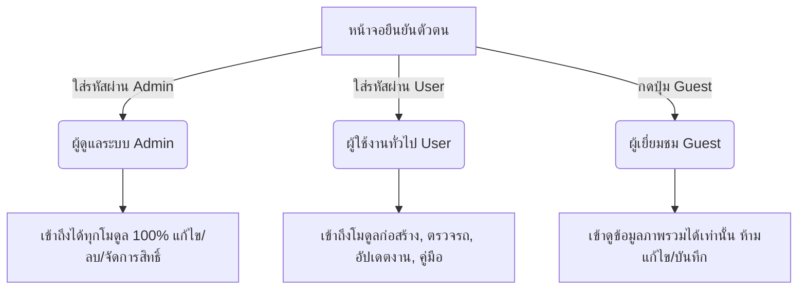
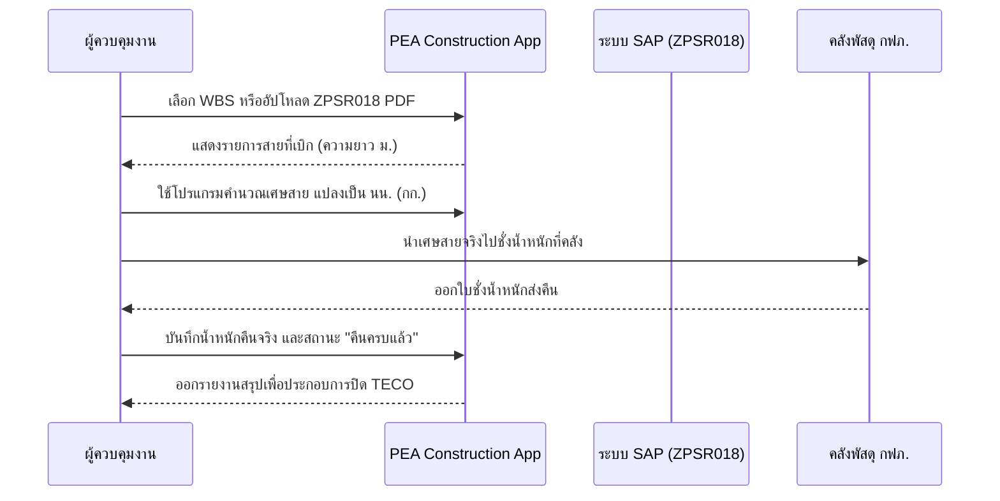

# คู่มือการใช้งานระบบบริหารและติดตามงานก่อสร้างระบบไฟฟ้า
## PEA Construction Application (ระบบ ผกร.กรย.กฟก.3)
**การไฟฟ้าส่วนภูมิภาค เขต 3 (ภาคกลาง) จังหวัดนครปฐม**  
**กองก่อสร้างระบบไฟฟ้า (กรย.กร.) | แผนกก่อสร้างและบูรณะระบบจำหน่าย (ผกร.(ก3))**

---

> **ลิงก์เข้าใช้งานระบบ:** [https://pea-construction-app.vercel.app/](https://pea-construction-app.vercel.app/)  
> **เวอร์ชันระบบ:** 2026.1 Enterprise Edition  
> **อุปกรณ์ที่รองรับ:** คอมพิวเตอร์ตั้งโต๊ะ (PC), แล็ปท็อป (Laptop), แท็บเล็ต (iPad/Tablet), และสมาร์ทโฟน (iOS/Android)  

---

## สารบัญ (Table of Contents)
1. [ภาพรวมระบบ (System Overview)](#1-ภาพรวมระบบ-system-overview)
   - 1.1 วัตถุประสงค์และประโยชน์ของระบบ
   - 1.2 สถาปัตยกรรมและการเชื่อมต่อข้อมูล
   - 1.3 กลุ่มเป้าหมายผู้ใช้งานและหน้าที่รับผิดชอบ
2. [การเข้าสู่ระบบและการตั้งค่าเริ่มต้น (Getting Started & Authentication)](#2-การเข้าสู่ระบบและการตั้งค่าเริ่มต้น-getting-started--authentication)
   - 2.1 การเข้าใช้งานผ่านเว็บเบราว์เซอร์
   - 2.2 ระดับสิทธิ์และรหัสผ่านเข้าใช้งาน (Access Roles)
   - 2.3 การติดตั้งแอปบนหน้าจอมือถือ (Add to Home Screen / PWA)
   - 2.4 การออกจากระบบ (Logout) และความปลอดภัยของ Session
3. [คู่มือการใช้งานทีละขั้นตอน (Step-by-Step User Guides)](#3-คู่มือการใช้งานทีละขั้นตอน-step-by-step-user-guides)
   - 3.1 ระบบบันทึกและตรวจสอบสภาพยานพาหนะ/รถยนต์ (Vehicle Inspection & C3 Fleet)
   - 3.2 ระบบรายงานการใช้น้ำมันเชื้อเพลิง (ยพ.6) และคำนวณ OT พขร.
   - 3.3 Dashboard งานก่อสร้างและสรุปภาพรวมโครงการ (Project Overview)
   - 3.4 ระบบอัปเดตสถานะงานภาคสนาม (Field Progress & GPS Tracking)
   - 3.5 ระบบติดตามและคำนวณการส่งคืนเศษสายเคเบิล (Wire Scrap Return)
   - 3.6 ระบบปฏิทินแผนงานระบบและแผนการใช้รถเครื่องจักร (Outage & Vehicle Schedule)
   - 3.7 ระบบจัดการงานฉุกเฉินและอุบัติเหตุรถชนเสา (Emergency & Incident Response)
   - 3.8 ระบบตรวจสอบความพร้อมปิดงานทางเทคนิคด้วย AI (TECO & SAP ZPSR018 Checker)
   - 3.9 ระบบเอกสารใบขอเบิกค่าใช้จ่ายและโอนงบประมาณ (Budget Transfer & Digital Signatures)
   - 3.10 โปรแกรมประมาณการค่าพัสดุและค่าแรงงาน (Cost & Assembly Estimation)
   - 3.11 คู่มือวิศวกรรมภาคสนาม 115 kV และ AI ผู้ช่วยอัจฉริยะ (Technical Guide & AI)
   - 3.12 ระบบจัดการบุคลากร ทะเบียนทีมงาน และคำนวณ OT พนักงาน บ.
   - 3.13 ระบบกำกับดูแลความปลอดภัยและตรวจเช็คอุปกรณ์ PPE (Safety Hub & PPE)
4. [การจัดการข้อผิดพลาดและคำถามที่พบบ่อย (Troubleshooting & FAQ)](#4-การจัดการข้อผิดพลาดและคำถามที่พบบ่อย-troubleshooting--faq)
   - 4.1 ปัญหาการยืนยันตัวตนและการจำรหัสผ่าน
   - 4.2 ปัญหาภาพถ่ายไม่อ่านพิกัด GPS อัตโนมัติ
   - 4.3 ปัญหาการพิมพ์รายงานและตั้งค่าหน้ากระดาษ
   - 4.4 ปัญหาการวิเคราะห์ไฟล์รายงาน SAP ZPSR018
   - 4.5 ช่องทางการติดต่อผู้ดูแลระบบและฝ่ายสนับสนุนเทคนิค

---

# 1. ภาพรวมระบบ (System Overview)

### 1.1 วัตถุประสงค์และประโยชน์ของระบบ
เว็บแอปพลิเคชัน **"PEA Construction App"** พัฒนาขึ้นโดยความร่วมมือของบุคลากรภายใน **แผนกก่อสร้างและบูรณะระบบจำหน่าย (ผกร.(ก3)) กองก่อสร้างระบบไฟฟ้า (กรย.กร.) การไฟฟ้าส่วนภูมิภาค เขต 3 (ภาคกลาง) จังหวัดนครปฐม** เพื่อยกระดับการปฏิบัติงานก่อสร้างระบบจำหน่ายและสายส่งไฟฟ้าสู่ระบบดิจิทัลแบบครบวงจร (Digital Construction Workflow) 

**ประโยชน์หลักของระบบ:**
* **Real-time Construction Tracking:** ติดตามสถานะความคืบหน้ารายวันของงานก่อสร้างตามรหัส WBS รายงานเปอร์เซ็นต์งาน และตรวจสอบพิกัด GPS หน้างานจริงผ่านรูปถ่าย
* **Safe Fleet & Inspection:** ตรวจสภาพความพร้อมของรถยนต์และรถเครื่องจักรกลหนัก (รถกระเช้า, รถเครน, รถสว่านขุดเจาะ) ก่อนออกปฏิบัติงาน เพื่อความปลอดภัยสูงสุดตามนโยบาย Safety First ของ กฟภ. พร้อมแจ้งเตือนผ่านกลุ่ม LINE
* **AI SAP ZPSR018 & TECO Audit:** นำเทคโนโลยีปัญญาประดิษฐ์ (Generative AI) มาช่วยสกัดและตรวจสอบรายงานพัสดุคงค้าง ZPSR018 จากระบบ SAP เพื่อตรวจสอบความพร้อมก่อนส่งปิดงาน TECO ลดขั้นตอนเอกสารตีกลับ
* **Digital Budget & Memo:** บริหารจัดการโอนงบประมาณระหว่าง Network ในระบบ SAP พร้อมสร้างบันทึกข้อความทางการ กฟภ. และระบบลงนามดิจิทัลอัตโนมัติ
* **Material & Scrap Return Tracking:** คำนวณน้ำหนักเศษสายเคเบิลตัวนำที่ต้องคืนคลังพัสดุตามเกณฑ์มาตรฐาน ป้องกันการตกหล่นของพัสดุที่มีมูลค่าสูง
* **Paperless & Rapid Communication:** ลดการใช้กระดาษ สามารถสั่งพิมพ์รายงานมาตรฐาน (ยพ.6, BOQ, ใบโอนงบประมาณ) ในรูปแบบ PDF ได้ทันที

### 1.2 สถาปัตยกรรมและการเชื่อมต่อข้อมูล
* **Frontend:** พัฒนาด้วย Next.js (React Server & Client Components) พร้อมการออกแบบ Responsive UI รองรับหน้าจอทุกขนาด
* **Cloud Database & Storage:** เชื่อมต่อกับ Supabase PostgreSQL สำหรับการจัดเก็บข้อมูลโครงการ ข้อมูลบุคลากร และบันทึกการตรวจสอบยานพาหนะ พร้อม Cloud Storage สำหรับภาพถ่ายหน้างาน
* **AI Engine:** ประมวลผลเอกสาร PDF ด้วยโมเดล Google Gemini ผ่าน Next.js API Routes สกัดข้อความและวิเคราะห์งบประมาณ-พัสดุคงค้าง
* **Integrated Subsystem:** ผสานระบบตรวจสอบยานพาหนะ C3 Vehicle Web และระบบแผนที่ดาวเทียม OpenStreetMap/Leaflet ในการปักหมุดจุดเกิดเหตุฉุกเฉิน

### 1.3 กลุ่มเป้าหมายผู้ใช้งานและหน้าที่รับผิดชอบ
| กลุ่มผู้ใช้งาน | ตำแหน่ง/สังกัด | บทบาทและฟังก์ชันที่เกี่ยวข้อง |
| :--- | :--- | :--- |
| **ผู้บริหาร / หัวหน้าแผนก** | หัวหน้าแผนกก่อสร้างและบูรณะระบบจำหน่าย (ชผ.กร.), รอง ผจก., อก.รย.(ก3) | ตรวจสอบภาพรวม Dashboard, ติดตามงานสำคัญ (Important Tasks), อนุมัติการโอนงบประมาณ, ดูสถิติความปลอดภัยและรายงานอุบัติเหตุ |
| **วิศวกร / ผู้ควบคุมงาน** | วิศวกรโครงการ, ช่างควบคุมงาน (พชง.7, พชง.6, พชง.5) | อัปเดตสถานะงานก่อสร้างรายวัน, ตรวจสอบปิดงาน TECO, จัดทำประมาณการ (Estimation), ตรวจสอบการคืนเศษสาย, วางแผนดับไฟปฏิบัติงาน |
| **หัวหน้าชุดงานภาคสนาม** | หัวหน้าชุดงานทั้ง 6 สาย (อุดมศักดิ์, วีรพัฒน์, ศุภวิชญ์, ขวัญนคร, ศราวุฒิ, สังกัดแผนก) | บันทึกความก้าวหน้าหน้างาน, แนบภาพถ่ายพร้อมพิกัด GPS, บันทึกการฝึกซ้อมความปลอดภัยประจำเดือน 10 หัวข้อ, ตรวจสอบอุปกรณ์ PPE |
| **พนักงานขับรถ (พขร.)** | พนักงานขับรถประจำรถบรรทุก, รถกระเช้า, รถเครน, รถสว่าน | ตรวจสภาพรถยนต์ประจำวัน 20 รายการ, ตรวจเครน 19 รายการ, ส่งรายงานตรวจเช็คเข้ากลุ่ม LINE, บันทึกการใช้น้ำมัน (ยพ.6) และตรวจสอบ OT |
| **เจ้าหน้าที่พัสดุและธุรการ** | พนักงาน Office ประจำแผนก | ตรวจสอบยอดส่งคืนเศษสายเคเบิล, บันทึกทะเบียนรถและประวัติการซ่อม, ออกรายงานน้ำมันประจำเดือน ยพ.6, จัดทำเอกสารขอเบิกเงิน |

---

# 2. การเข้าสู่ระบบและการตั้งค่าเริ่มต้น (Getting Started & Authentication)

### 2.1 การเข้าใช้งานผ่านเว็บเบราว์เซอร์
1. เปิดโปรแกรมเว็บเบราว์เซอร์ที่แนะนำ เช่น **Google Chrome**, **Microsoft Edge**, หรือ **Safari**
2. ไปที่ URL: [https://pea-construction-app.vercel.app/](https://pea-construction-app.vercel.app/)
3. ระบบจะแสดงหน้าต่าง **"ระบบจำกัดการเข้าถึง (Protected Access)"** เพื่อรักษาความปลอดภัยของข้อมูลภายในองค์กร

### 2.2 ระดับสิทธิ์และรหัสผ่านเข้าใช้งาน (Access Roles)
ระบบแบ่งระดับการเข้าถึงออกเป็น 3 ระดับ เพื่อความปลอดภัยของข้อมูลโครงการ:



1. **ระดับผู้ดูแลระบบ (Admin Role):**
   - **รหัสผ่าน:** `Cha16072534` (หรือ `Cha16072534--`)
   - **สิทธิ์การใช้งาน:** เข้าถึงทุกหน้าของระบบได้ 100% รวมถึงเมนูบริหารจัดการพิเศษ เช่น จัดการข้อมูลบุคลากร, มอบหมายงาน (My Tasks), ติดตามพัสดุช่าง, รายงาน Safety Hub, และแก้ไข/ลบข้อมูลโครงการ
2. **ระดับเจ้าหน้าที่และผู้ใช้งาน (User Role):**
   - **รหัสผ่าน:** `pscc3`
   - **สิทธิ์การใช้งาน:** สามารถเข้าดู Dashboard, อัปเดตสถานะงานประจำวัน, คำนวณเศษสาย, บันทึกตรวจรถยนต์/ยพ.6, ตรวจสอบปิดงาน TECO, ดูคู่มือ 115 kV และบันทึกแบบฟอร์มต่างๆ
3. **ระดับผู้เยี่ยมชม (Guest Mode / Read-Only):**
   - **วิธีการเข้าใช้งาน:** กดปุ่ม **"เข้าใช้งานโหมดผู้เยี่ยมชม (ดูเท่านั้น)"** ด้านล่างฟอร์มล็อกอิน โดยไม่ต้องกรอกรหัสผ่าน
   - **สิทธิ์การใช้งาน:** ดูข้อมูลสถิติและสถานะภาพรวมได้เท่านั้น โดยระบบจะปิดกั้นเมนูที่มีความละเอียดอ่อนและปุ่มบันทึก/แก้ไขข้อมูล

### 2.3 การติดตั้งแอปบนหน้าจอมือถือ (Add to Home Screen / PWA)
เพื่อให้เปิดใช้งานได้อย่างสะดวกรวดเร็วเสมือนแอปพลิเคชันมือถือ โดยไม่ต้องพิมพ์ URL ซ้ำ:
* **สำหรับอุปกรณ์ iOS (iPhone / iPad - Safari):**
  1. เปิดหน้าเว็บด้วย Safari
  2. กดปุ่ม **แชร์ (Share Icon - สี่เหลี่ยมที่มีลูกศรชี้ขึ้น)** ที่แถบด้านล่าง
  3. เลื่อนลงมาแล้วเลือก **"เพิ่มไปยังหน้าจอโฮม (Add to Home Screen)"**
  4. ตั้งชื่อเป็น "PEA Construction" แล้วกด **"เพิ่ม (Add)"**
* **สำหรับอุปกรณ์ Android (Google Chrome):**
  1. เปิดหน้าเว็บด้วย Google Chrome
  2. กดปุ่มเมนู **จุดไข่ปลา 3 จุด (⋮)** ที่มุมบนขวา
  3. เลือก **"ติดตั้งแอป (Install App)"** หรือ **"เพิ่มลงในหน้าจอหลัก (Add to Home screen)"**
  4. กดยืนยัน ไอคอนระบบจะปรากฏบนหน้าจอหลักของโทรศัพท์ทันที

### 2.4 การออกจากระบบ (Logout) และความปลอดภัยของ Session
* ระบบรักษาความปลอดภัยด้วย `sessionStorage` 
* หากต้องการออกจากระบบ ให้เปิดแถบเมนูด้านซ้าย (Sidebar) เลื่อนลงมาด้านล่างสุด แล้วกดปุ่มสีแดง **"ออกจากระบบ (Logout)"**
* **ข้อควรระวัง:** การเปิดใช้งานผ่านโหมดไม่ระบุตัวตน (Incognito / Private Browsing) จะทำให้ระบบล้างเซสชันทันทีที่ปิดแท็บ เพื่อการใช้งานที่ราบรื่นแนะนำให้ใช้โหมดเบราว์เซอร์ปกติ

---

# 3. คู่มือการใช้งานทีละขั้นตอน (Step-by-Step User Guides)

---

## 3.1 ระบบบันทึกและตรวจสอบสภาพยานพาหนะ/รถยนต์ (Vehicle Inspection & C3 Fleet)
> **เมนูนำทาง:** เมนูด้านซ้าย -> หมวด "ยานพาหนะและเชื้อเพลิง" -> **"ระบบยานพาหนะ"**  
> **URL โดยตรง:** [https://c3-vehicle-web.vercel.app/](https://c3-vehicle-web.vercel.app/)

ระบบนี้จัดทำขึ้นสำหรับพนักงานขับรถ (พขร.) และผู้ควบคุมยานพาหนะ เพื่อบันทึกการตรวจสอบสภาพรถยนต์และเครื่องจักรกลหนักประจำวันก่อนนำรถออกปฏิบัติงาน ลดความเสี่ยงในการเกิดอุบัติเหตุทางถนนและงานชำรุดระหว่างทาง

```
[ขั้นตอนการตรวจรถประจำวัน]
1. เลือกเมนู "ตรวจรถยนต์" หรือ "ตรวจเครนไฮดรอลิค"
2. ระบุ วันที่, ทะเบียนรถ, และชื่อผู้ตรวจสอบ
3. ตรวจเช็ครายการตรวจสอบ (20 รายการสำหรับรถยนต์ / 19 รายการสำหรับเครน)
4. เลือกสถานะ "ปกติ" หรือ "แก้ไข" (หากพบข้อบกพร่องให้ระบุรายละเอียดอาการ)
5. กดยืนยันบันทึกข้อมูล -> ระบบส่ง LINE Notify และจัดเก็บลงฐานข้อมูล
6. ไปที่เมนู "สรุปส่งไลน์" เพื่อคัดลอกข้อความรายงานส่งเข้ากลุ่มงาน
```

### 1) การตรวจสภาพรถยนต์ทั่วไป (Vehicle Checklist - 20 รายการ)
1. คลิกแท็บ **"ตรวจรถยนต์"**
2. เลือก **วันที่ตรวจ** (ระบบจะตั้งค่าเป็นวันที่ปัจจุบันโดยอัตโนมัติ)
3. เลือก **หมายเลขทะเบียนรถ** จากรายการ Dropdown (เช่น `90-1843 นฐ`, `89-5769 นฐ`, `6ขล-1943 กทม`)
4. เลือก **ชื่อผู้ตรวจ** (พขร. หรือหัวหน้าชุดงาน)
5. ทำการตรวจเช็คสภาพจริงรอบคันตามรายการทั้ง 20 ข้อ:
   - *หมวดความปลอดภัย:* เข็มขัดนิรภัย, อุปกรณ์ดับเพลิง, กระจกหน้ารถ, กระจกมองข้าง/หลัง, ที่ปัดน้ำฝนและน้ำฉีดกระจก
   - *หมวดระบบไฟสัญญาณ:* ไฟส่องสว่าง (สูง-ต่ำ) หน้า-หลัง, ไฟเบรก, ไฟสัญญาณ (ไฟวับวาบ, เลี้ยวซ้าย-ขวา, ถอยหลัง), แตร
   - *หมวดของเหลวและเครื่องยนต์:* ระดับน้ำมันเชื้อเพลิง, ระดับน้ำมันหล่อลื่นเครื่องยนต์, แบตเตอรี่ (ขั้วและระดับน้ำกลั่น), เครื่องปรับอากาศ
   - *หมวดช่วงล่างและตัวถัง:* ระบบเบรก (เบรกมือ/เบรกเท้า), สภาพยาง กระทะล้อ และน็อตยึดล้อ, การทำความสะอาดภายใน-ภายนอก, รอยความเสียหายตัวถัง
6. หากข้อใดผิดปกติ ให้คลิกเลือก **"แก้ไข"** และพิมพ์ระบุอาการชำรุดในช่องข้อความ
7. กดปุ่ม **"บันทึกข้อมูลการตรวจรถ"** ระบบจะบันทึกลงฐานข้อมูลและส่งการแจ้งเตือนไปยังกลุ่ม LINE ทันที

### 2) การตรวจเครนไฮดรอลิคและเครื่องจักรกลหนัก (Crane Checklist - 19 รายการ)
1. สำหรับรถบรรทุกติดเครน, รถเครนขนาด 25, 30, 35 ตัน/เมตร และรถสว่านขุดเจาะ ให้คลิกแท็บ **"ตรวจเครนไฮดรอลิค"**
2. เลือกทะเบียนรถเครน และชื่อผู้ตรวจ
3. ตรวจสอบระบบไฮดรอลิคและชิ้นส่วนกลไก 19 รายการ:
   - ระบบคอนโทรล, เกียร์ฝาก (PTO), ปั๊มไฮดรอลิค, สายไฮดรอลิค, ระดับน้ำมันไฮดรอลิค
   - กระบอกหมุนเครน, เสาเครนและลูกปืน, กระบอกขาช้างหน้า-หลัง ซ้าย-ขวา
   - กระบอกยกบูมและกระบอกยืดหดบูม (ใน-นอก), แผ่นรองเลื่อน (Wear Pads)
   - ชุดกว้าน (Winch) และเบรควินซ์, ลวดสลิงและรอก, หัวเจาะสว่าน (กรณีรถสว่าน)
   - ตะขอ (Hook) ต้องมีตัวล็อกสลิงกันหลุด (Safety Latch) สมบูรณ์ 100%, ไฟสัญญาณวับวาบ และเกจชั่วโมงการทำงาน
4. กดปุ่ม **"บันทึกข้อมูลการตรวจเครน"**

### 3) การดู Dashboard สรุปความพร้อมของยานพาหนะ
* คลิกแท็บ **"ภาพรวม (Dashboard)"**
* ด้านบนจะแสดงวงแหวนสัดส่วนการตรวจเช็คประจำวัน (Progress Ring):
  * **สีเขียว (100%):** รถทุกคันได้รับการตรวจเช็คครบถ้วน
  * **สีส้ม/แดง (< 100%):** มียานพาหนะที่ยังค้างการตรวจเช็ค
* ตาราง **"รายการผิดปกติที่ต้องแก้ไข"** จะดึงเฉพาะรถที่มีรายการเสียหรือต้องซ่อมแซมขึ้นมาแสดงเตือนฝ่ายยานพาหนะทันที
* ตาราง **"รถที่ยังไม่ได้ตรวจในวันนี้"** แสดงทะเบียนรถและคนขับที่ยังไม่ได้ส่งผลตรวจ เพื่อให้ผู้ควบคุมงานติดตามได้ทันเวลา

### 4) การสร้างข้อความสรุปส่งเข้ากลุ่ม LINE (LINE Summary Generator)
1. คลิกแท็บ **"สรุปส่งไลน์"**
2. เลือกรายการรถที่เพิ่งตรวจจาก Dropdown
3. ระบบจะสร้างข้อความรายงานทางการ กฟภ. โดยอัตโนมัติ เช่น:
   ```text
   วันที่ 20 ต.ค. 2569
   ผกร.กรย.กฟก.3 ตรวจสอบยานพาหนะ
   ทะเบียน 90-1843 นฐ ก่อนออกปฏิบัติงาน 
   เพื่อความปลอดภัย ได้ดำเนินการตรวจสอบ ดังนี้

   ✅ ระดับน้ำมันเครื่อง       ผลปกติ
   ✅ ระดับน้ำหล่อเย็น         ผลปกติ
   ✅ ระบบน้ำมันเกียร์         ผลปกติ
   ✅ ระดับน้ำมันหล่อลื่น      ผลปกติ
   ✅ สภาพยาง                  ผลปกติ
   ✅ แบตเตอรี่                  ผลปกติ
   ✅ ระบบไฟต่างๆ             ผลปกติ
   ✅ ถังดับเพลิง                ผลปกติ

   โดย นายขวัญนคร ศรีจันทร์อินทร์
   (พขร.บ.) ผู้ตรวจสอบ
   ```
4. กดปุ่ม **"คัดลอกข้อความ"** แล้วนำไปวางในกลุ่ม LINE ก่อสร้างได้ทันที

---

## 3.2 ระบบรายงานการใช้น้ำมันเชื้อเพลิง (ยพ.6) และคำนวณ OT พขร.
> **เมนูนำทาง:** เมนูด้านซ้าย -> หมวด "ยานพาหนะและเชื้อเพลิง" -> **"รายงานน้ำมัน (ยพ.6)"** และ **"คำนวณ OT พขร."**

### 1) การบันทึกรายงานการใช้รถและน้ำมันเชื้อเพลิง (แบบ ยพ.6)
1. เข้าไปที่เมนู **"รายงานน้ำมัน (ยพ.6)"** แท็บ **"บันทึกข้อมูลการใช้รถ"**
2. กรอกรายละเอียดการปฏิบัติงานประจำวัน:
   * **วันที่ใช้งาน:** เลือกวันที่นำรถออกใช้งาน
   * **หมายเลขทะเบียน:** เลือกทะเบียนรถ ระบบจะจับคู่ชื่อ พขร. และรหัสรถให้อัตโนมัติ
   * **ผู้ควบคุมงาน / สถานที่ไปปฏิบัติงาน:** เช่น "งานก่อสร้างสายส่ง อ.กำแพงแสน จ.นครปฐม"
   * **เลขไมล์เริ่มต้น - เลขไมล์สิ้นสุด:** ระบบจะคำนวณระยะทางรวม (กม.) ให้ทันที
   * **ชั่วโมงการทำงานเครื่องจักร (ถ้ามี):** สำหรับรถเครนและรถสว่าน
   * **การเติมน้ำมันเชื้อเพลิง:** เลือกประเภทน้ำมัน, จำนวนลิตร, และจำนวนเงิน (บาท)
   * **ค่าซ่อมแซม/บำรุงรักษาฉุกเฉิน (ถ้ามี):** ระบุรายละเอียดและยอดเงิน
3. กดปุ่ม **"บันทึกข้อมูล ยพ.6"**

### 2) การออกรายงานสรุปประจำเดือน (Monthly Print Report)
1. คลิกแท็บ **"รายงานสรุปประจำเดือน"**
2. เลือก **เดือน**, **ปี พ.ศ.**, และ **หมายเลขทะเบียนรถ** ที่ต้องการสรุป
3. กดปุ่ม **"ค้นหารายงาน"** ระบบจะรวบรวมข้อมูลการใช้งานตลอดทั้งเดือน คำนวณระยะทางรวม จำนวนลิตรน้ำมันทั้งหมด และอัตราสิ้นเปลืองเฉลี่ย (กม./ลิตร)
4. จัดรูปแบบตารางตามแบบฟอร์มมาตรฐาน **ยพ.6 ของ กฟภ.** พร้อมช่องลงลายมือชื่อ พขร., ช่างควบคุมงาน, และหัวหน้าแผนก (ชผ.กร.)
5. กดปุ่ม **"พิมพ์รายงาน ยพ.6 (PDF)"** เพื่อพิมพ์เอกสารส่งฝ่ายบัญชีและการเงิน

### 3) การคำนวณค่าล่วงเวลา (OT) และเบี้ยเลี้ยง พขร.
1. เข้าไปที่เมนู **"คำนวณ OT พขร."**
2. เลือกชื่อพนักงานขับรถ ระบบจะกำหนดประเภทตำแหน่งให้อัตโนมัติ:
   * **ชนิดที่ 2:** รถบรรทุกทั่วไป
   * **ชนิดที่ 2+:** รถบรรทุกติดเครน 6 ตัน, รถสว่าน
   * **ชนิดที่ 2+พิเศษ:** เครนพิกัดสูง 25, 30, 35 ตัน/เมตร
   * **ชนิดที่ 3+:** รถเทรลเลอร์ลากจูงติดเครน
3. ระบุวันและช่วงเวลาปฏิบัติงาน (Start Time - End Time)
4. เลือกว่าเป็น **"วันหยุดประจำสัปดาห์ / วันหยุดนักขัตฤกษ์"** หรือไม่
5. ระบบจะคำนวณแยกประเภทชั่วโมงการทำงานตามระเบียบ กฟภ. อย่างแม่นยำ:
   * หักเวลาพักเที่ยง (12:00 - 13:00 น.) อัตโนมัติ
   * คำนวณอัตรา 1.0 เท่า, 1.5 เท่า, และ 3.0 เท่า
   * คำนวณค่าเบี้ยเลี้ยงที่พัก (400 บาท/คืน) กรณีไปค้างแรมต่างพื้นที่
6. สรุปยอดเงินรวมสุทธิที่ต้องเบิกจ่าย พร้อมสั่งพิมพ์ใบแจ้งยอด

---

## 3.3 Dashboard งานก่อสร้างและสรุปภาพรวมโครงการ (Project Overview)
> **เมนูนำทาง:** เมนูด้านซ้าย -> หมวด "หน้าหลัก" -> **"Dashboard งานก่อสร้าง"**

หน้านี้เปรียบเสมือนศูนย์ควบคุมและติดตามโครงการก่อสร้างทั้งหมดของ ผกร.(ก3) เหมาะสำหรับผู้บริหารและวิศวกรในการประเมินความก้าวหน้า

```
+-----------------------------------------------------------------------------------+
|  [โครงการทั้งหมด 128 งาน]   [กำลังดำเนินงาน 45 งาน]   [รอดำเนินการ 12 งาน]   [แล้วเสร็จ 71 งาน]  |
+-----------------------------------------------------------------------------------+
|  ตัวกรอง: [ปีงบประมาณ v]  [ผู้ควบคุมงาน v]  [สถานะงาน v]  [แผนปิดงาน v]  [ช่องค้นหา WBS...]   |
+-----------------------------------------------------------------------------------+
|  กราฟแท่งเปรียบเทียบสถานะงาน  |  ตารางรายชื่อโครงการ, % ความคืบหน้า, มูลค่างาน, ปุ่มพิมพ์สรุป  |
+-----------------------------------------------------------------------------------+
```

### ขั้นตอนการใช้งานตัวกรองหลายมิติ (Multi-Filtering)
1. **การกรองตามปีงบประมาณ (Fiscal Year):** เลือกระหว่าง "ก่อนปี 2568", "ปี 2568", หรือ "ปี 2569" เพื่อแยกกลุ่มงานตามแผนจัดสรรงบ
2. **การกรองตามผู้ควบคุมงาน (Supervisor):** เลือกดูเฉพาะงานที่รับผิดชอบโดยบุคคล เช่น นายอุดมศักดิ์, นายวีรพัฒน์, นายศราวุฒิ ฯลฯ
3. **การค้นหาแบบรวดเร็ว (Quick Search):** พิมพ์เฉพาะบางส่วนของเลข WBS (เช่น `66-` หรือ `67-`) หรือพิมพ์ชื่อสถานที่ก่อสร้างในช่องค้นหา ตารางจะแสดงผลทันทีโดยไม่ต้องกด Enter
4. **การดูการ์ดสรุปตัวเลข (Key Metrics Cards):** คลิกที่การ์ดสถานะ (เช่น คลิกการ์ด "F4" หรืองานสถานะอื่นๆ) เพื่อกรองเฉพาะงานกลุ่มนั้นขึ้นมาดูแบบรวดเร็ว
5. **การพิมพ์เอกสารสรุปความคืบหน้า:** กดปุ่ม **"พิมพ์หน้านี้ (Print Report)"** ที่มุมขวาบน ระบบจะจัดหน้ากระดาษ A4 แนวนอน พร้อมซ่อนปุ่มและแถบเครื่องมือที่ไม่จำเป็นออก เพื่อให้ได้เอกสารสรุปการประชุมที่สะอาดตา

---

## 3.4 ระบบอัปเดตสถานะงานภาคสนาม (Field Progress & GPS Tracking)
> **เมนูนำทาง:** เมนูด้านซ้าย -> หมวด "หน้าหลัก" -> **"อัปเดตสถานะงาน"**

เป็นโมดูลหลักสำหรับวิศวกรและผู้ควบคุมงานภาคสนามในการส่งความคืบหน้าประจำวัน แนบรูปถ่ายหน้างาน และปักหมุดพิกัดแผนที่

### ขั้นตอนการอัปเดตสถานะโครงการ
1. **เลือกโครงการ:** ค้นหาโครงการด้วยเลข WBS หรือคลิกเลือกจากรายการโครงการที่รับผิดชอบ
2. **ระบุข้อมูลความคืบหน้า (Progress Details):**
   * ระบุเปอร์เซ็นต์ความก้าวหน้าของงาน (0 - 100%)
   * เลือกสถานะโครงการ (เช่น อยู่ระหว่างก่อสร้าง, ปักเสาพาดสายเสร็จสิ้น, รอจ่ายไฟ, ส่งมอบงาน)
   * ระบุวันที่เริ่มงานจริง และวันที่คาดว่าจะแล้วเสร็จ
   * ระบุ **แผนดำเนินการถัดไป (Action Plan)** และ **แผนปิดงาน (Closing Plan)**
3. **บันทึกรายการตรวจสอบตามขั้นตอนงาน (Milestones Checklist):**
   * ติ๊กเครื่องหมายถูกในขั้นตอนที่แล้วเสร็จ (เช่น ขออนุมัติดับไฟ, สำรวจปักหมุด, ปักเสา, พาดสาย, ติดตั้งอุปกรณ์หม้อแปลง/สวิตช์, ตรวจรับทางเทคนิค)
4. **การอัปโหลดภาพถ่ายหน้างานพร้อมสกัดพิกัด GPS อัตโนมัติ:**
   * กดปุ่ม **"เลือกภาพถ่าย"** หรือถ่ายภาพผ่านกล้องมือถือ
   * ระบบจะอ่านข้อมูล **EXIF Metadata** ภายในไฟล์ภาพโดยอัตโนมัติ เพื่อดึงค่า **Latitude / Longitude** และเวลาถ่ายภาพ
   * แสดงหมุดตำแหน่งงานบนแผนที่ พร้อมระบุสัญลักษณ์ยืนยันตำแหน่งจริงหน้างาน
5. **บันทึกประวัติการดำเนินงาน (Daily Remarks):**
   * พิมพ์รายละเอียดสิ่งที่ทำในวันนี้ ปัญหาหรืออุปสรรคที่พบ
   * ระบบจะบันทึกวันที่ เวลา และพิกัด 📍 แนบไว้ท้ายข้อความอัตโนมัติ
6. กดปุ่ม **"บันทึกข้อมูล (Save Progress)"** ระบบจะบันทึกเข้าฐานข้อมูล และจัดเก็บในแท็บ **"ประวัติการอัปเดต (Update History)"** เพื่อตรวจสอบย้อนหลังได้ตลอดเวลา

---

## 3.5 ระบบติดตามและคำนวณการส่งคืนเศษสายเคเบิล (Wire Scrap Return)
> **เมนูนำทาง:** เมนูด้านซ้าย -> หมวด "หน้าหลัก" -> **"สถานะการคืนเศษสาย"**

เศษสายตัวนำทองแดงและอะลูมิเนียมเป็นพัสดุที่มีมูลค่าสูงและต้องมีระบบควบคุมทางบัญชีที่เข้มงวด ระบบนี้ช่วยติดตามตั้งแต่การเบิกจากคลังจนถึงการชั่งส่งคืน



### ขั้นตอนการใช้งาน
1. **ค้นหาโครงการ:** เลือกโครงการตามเลข WBS
2. **การนำเข้าข้อมูลสายอัตโนมัติจากไฟล์ SAP ZPSR018:**
   * กดปุ่ม **"อัปโหลดรายงาน SAP (ZPSR018 PDF)"**
   * ระบบจะสแกนหารายการพัสดุประเภทสายเคเบิล (เช่น สายเปลือย All Aluminium Conductor, สาย SAC, สายแรงดันสูง XLPE) ดึงรหัสพัสดุและจำนวนความยาวที่เบิกเข้าสู่ระบบทันที
3. **การใช้งานโปรแกรมคำนวณเศษสาย (Wire Calculator):**
   * คลิกไอคอน **เครื่องคิดเลข (Calculator)**
   * เลือกประเภทสายตัวนำตามมาตรฐาน กฟภ. (เช่น 35 sq.mm., 50 sq.mm., 185 sq.mm.)
   * ป้อนความยาวสาย (เมตร) หรือใส่น้ำหนักที่ต้องการแปลงกลับ
   * ระบบจะคำนวณน้ำหนักสายมาตรฐาน (กก./กม.) และประมาณการน้ำหนักเศษสายที่ต้องคืนตามสัดส่วนร้อยละ
4. **บันทึกผลการส่งคืน:**
   * กรอกน้ำหนักที่ชั่งคืนจริง ณ คลังพัสดุ
   * เลือกสถานะ: **"ยังไม่คืน"**, **"คืนบางส่วน"**, หรือ **"คืนครบเรียบร้อยแล้ว"**
   * กดปุ่ม **"บันทึกข้อมูลเศษสาย"**

---

## 3.6 ระบบปฏิทินแผนงานระบบและแผนการใช้รถเครื่องจักร (Outage & Vehicle Schedule)
> **เมนูนำทาง:** เมนูด้านซ้าย -> หมวด "หน้าหลัก" -> **"แผนงานระบบ / แผนใช้รถ"**

ใช้ในการประสานงานตารางดับกระแสไฟฟ้าเพื่อปฏิบัติงานก่อสร้างร่วมกับศูนย์สั่งการจ่ายไฟ (Dispatcher) พร้อมจัดสรรยานพาหนะเครื่องจักรกลหนักไม่ให้เกิดการใช้งานชนกัน

### ขั้นตอนการใช้งาน
1. **ดูปฏิทินรายเดือน:** สามารถคลิกปุ่ม `<` หรือ `>` เพื่อเปลี่ยนเดือนที่ต้องการดู
2. **ความหมายของแถบสีในปฏิทิน:**
   * **แถบสีม่วง/น้ำเงิน:** งานดับไฟของหน่วยงานตนเอง (ผกร.)
   * **แถบสีส้ม/เขียว:** งานภายนอก / แผนกอื่นหรือการไฟฟ้าสาขาขอความร่วมมือสนับสนุน
3. **การเพิ่มแผนงานดับไฟใหม่:**
   * คลิกที่วันที่ต้องการในปฏิทิน
   * กรอกเลข WBS, ชื่องานก่อสร้าง, และพื้นที่บริเวณที่ต้องดับกระแสไฟฟ้า
   * กำหนดช่วงเวลาดับไฟ (เช่น 08:30 - 16:30 น.)
   * เลือกรถเครื่องจักรกลหนักที่ต้องเข้าพื้นที่ (เช่น รถกระเช้า 90-2230 นฐ, รถเครน 30 ตัน 90-7311 นฐ)
4. กด **"บันทึกแผนงาน"** แถบสีจะปรากฏบนปฏิทินทันที เพื่อให้ทุกทีมทราบล่วงหน้าและจัดเตรียมอุปกรณ์ป้องกันตนเอง

---

## 3.7 ระบบจัดการงานฉุกเฉินและอุบัติเหตุรถชนเสา (Emergency & Incident Response)
> **เมนูนำทาง:** เมนูด้านซ้าย -> หมวด "บริหาร/วางแผนงานก่อสร้าง" -> **"งานฉุกเฉิน/รถชนเสา"**

ออกแบบมาเพื่อตอบสนองต่อสถานการณ์วิกฤต เช่น พายุพัดเสาไฟฟ้าล้ม หรืออุบัติเหตุยานพาหนะชนเสาหักโค่น ต้องการประเมินพัสดุและระดมทีมงานอย่างเร่งด่วน

```
[แผนภาพขั้นตอนการจัดการเหตุฉุกเฉิน]
อัปโหลดภาพถ่ายเสาหัก -> อ่าน GPS ปักหมุดบนแผนที่ดาวเทียม -> เลือกระบุความเสียหายและจำนวนเสา 
-> ระบบคำนวณรายการพัสดุเบิกด่วน -> สรุปจำนวนทีมงานและรถกระเช้า -> ส่งออกรายงานด่วนเข้ากลุ่ม LINE
```

### ขั้นตอนการปฏิบัติการ
1. คลิกปุ่ม **"สร้างเหตุการณ์ฉุกเฉินใหม่ (New Incident)"**
2. ระบุหัวข้องาน เช่น *"รถบรรทุกชนเสาหัก 3 ต้น หน้า รพ.นครปฐม ถ.เพชรเกษม"*
3. **อัปโหลดภาพถ่ายความเสียหายภาคสนาม:**
   * เมื่ออัปโหลดภาพถ่าย ระบบจะดึงพิกัดจากรูปและปักหมุดบนแผนที่ดาวเทียมทันที
   * หากรูปถ่ายไม่มีพิกัด สามารถคลิกบนแผนที่เพื่อเลื่อนหมุดไปยังจุดเกิดเหตุจริงได้โดยตรง
4. **ระบุรายละเอียดความเสียหายและอุปกรณ์ที่ต้องใช้:**
   * ป้อนขนาดเสาที่หัก (เช่น เสา คอร. 12 ม., 14 ม., 22 ม.) และจำนวนต้น
   * ป้อนจำนวนคาน, ลูกถ้วย, สปริงเกอร์, หรือสายตัวนำที่ขาด
5. **การรวมยอดพัสดุด่วน (Material Aggregation):**
   * กดปุ่ม **"สรุปรายการพัสดุเบิกด่วน"** ระบบจะรวบรวมยอดอุปกรณ์ทั้งหมดที่ต้องสั่งเบิกจากคลังฉุกเฉิน
   * คำนวณจำนวนชุดงานและรถเครนที่ต้องระดมเข้าพื้นที่
6. **แชร์ข้อมูล:** บันทึกและพิมพ์รายงานหรือจับภาพหน้าจอส่งให้ผู้บริหารและทีมกู้ภัยไฟฟ้าทันที

---

## 3.8 ระบบตรวจสอบความพร้อมปิดงานทางเทคนิคด้วย AI (TECO & SAP ZPSR018 Checker)
> **เมนูนำทาง:** เมนูด้านซ้าย -> หมวด "ตรวจสอบและเอกสาร" -> **"ตรวจสอบปิดงาน (TECO)"**

การปิดงานทางเทคนิค (Technical Completion: TECO) ในระบบ SAP มักประสบปัญหาเอกสารตีกลับเนื่องจากมีรายการพัสดุค้างเบิก หรือมียอดภาระผูกพัน (Commitment) คงค้าง โมดูลนี้ใช้ AI ช่วยตรวจสอบล่วงหน้า 100%

### ขั้นตอนการตรวจสอบ
1. **เลือกโครงการ:** เลือก WBS ที่ต้องการส่งปิดงาน
2. **อัปโหลดรายงาน SAP ZPSR018:**
   * ไปที่ระบบ SAP ทำการ Export รายงาน ZPSR018 ออกมาเป็นไฟล์ PDF
   * ลากไฟล์ PDF มาวางในกล่องอัปโหลด (Drag & Drop) หรือกดปุ่ม Browse File
3. **กดปุ่ม "วิเคราะห์ความพร้อมปิดงาน (Analyze TECO)":**
   * ระบบจะประมวลผลผ่านโมเดล Generative AI (Gemini) สแกนทุกบรรทัดในรายงาน
4. **อ่านรายงานผลการตรวจสอบ (Audit Checklist Result):**
   * **1. งบประมาณและค่าใช้จ่ายจริง:** เช็คว่า Actual Cost เกินงบที่ได้รับอนุมัติหรือไม่ (✅ ผ่าน / ❌ เกินงบ)
   * **2. ภาระผูกพันคงค้าง (Commitments):** ตรวจสอบว่ายังมีใบสั่งซื้อ/สั่งจ้าง (PO) หรือใบขอซื้อ (PR) ค้างจ่ายหรือไม่
   * **3. พัสดุเบิก-จ่าย:** เช็คยอดพัสดุที่เบิกมาว่ามีการตัดจ่ายลงงานครบถ้วนหรือไม่
   * **4. การคืนเศษสายไฟ:** เปรียบเทียบยอดการคืนเศษสายในระบบกับตัวเลขใน ZPSR018
   * **5. ค่าแรงและค่าควบคุมงาน:** ตรวจสอบว่าลงบัญชีค่าแรงงานครบถ้วนหรือไม่
5. **แนวทางแก้ไข (Actionable Advice):** หากมีข้อผิดพลาด ❌ ระบบ AI จะแนะนำขั้นตอนการแก้ไขในระบบ SAP อย่างตรงจุด เพื่อให้ผู้ควบคุมงานไปดำเนินการแก้ไขก่อนส่งทำ TECO จริง

---

## 3.9 ระบบเอกสารใบขอเบิกค่าใช้จ่ายและโอนงบประมาณ (Budget Transfer & Digital Signatures)
> **เมนูนำทาง:** เมนูด้านซ้าย -> หมวด "ตรวจสอบและเอกสาร" -> **"เอกสารใบขอเบิกค่าใช้จ่าย"**

ใช้สำหรับจัดทำบันทึกข้อความทางการของ กฟภ. เพื่อขออนุมัติโอนจัดสรรงบประมาณระหว่าง Network ในระบบ SAP (เช่น โอนงบจากหมวดพัสดุมาเสริมหมวดค่าแรงหน้างานวันอาทิตย์)

### ขั้นตอนการทำเอกสาร (3 ขั้นตอน)
* **ขั้นตอนที่ 1: กรอกข้อมูลโครงการและส่วนราชการ (Project Info)**
  * กรอกเลขที่หนังสือ, วันที่, เลข WBS, และชื่อโครงการ
  * กำหนดต้นเรื่อง (จาก: กรย.(ก3)) และปลายทาง (ถึง: อฝ.วบ.(ก3))
  * เลือกเหตุผลความจำเป็นในการโอนงบประมาณ (มีข้อความมาตรฐาน กฟภ. เตรียมไว้ให้)
* **ขั้นตอนที่ 2: จัดสรรและโอนงบประมาณระหว่าง Network (Transfer Allocation)**
  * นำเข้าข้อมูลงบประมาณจากรายงาน ZPSR018
  * ระบบจะแสดงตาราง Matrix และ **แผนผังลูกศรแสดงทิศทางการโอนเงิน (Visual Flowchart)**
  * เลือกว่าจะโอนงบจาก Network ใดไปยัง Network ใด ในหมวดค่าแรง, ค่าควบคุมงาน, หรือค่าใช้จ่ายหน้างาน
  * ระบบคำนวณยอดเงินคงเหลือหลังการโอนแบบเรียลไทม์ ป้องกันงบประมาณติดลบ
* **ขั้นตอนที่ 3: แบบฟอร์มทางการและการลงนามดิจิทัล (Memo & Signatures)**
  * แสดงตัวอย่างเอกสารบันทึกข้อความราชการตามระเบียบสารบรรณ กฟภ. มีตราสัญลักษณ์ถูกต้อง
  * ระบุชื่อผู้ลงนาม:
    * ผู้ขอเบิก / ผู้ควบคุมงาน
    * ผู้เสนอเรื่อง: นายอนันต์ กาญจนอุปถัมภ์ (รก.รย.(ก3) ปฏิบัติงานแทน อก.รย.(ก3))
    * ผู้อนุมัติ: นายเมธี สุกก่ำ (อฝ.วบ.(ก3))
  * กดปุ่ม **"พิมพ์ / บันทึก PDF"** หรือบันทึกเป็นรูปภาพ PNG เพื่อแนบส่งในระบบงานสารบรรณอิเล็กทรอนิกส์

---

## 3.10 โปรแกรมประมาณการค่าพัสดุและค่าแรงงาน (Cost & Assembly Estimation)
> **เมนูนำทาง:** เมนูด้านซ้าย -> หมวด "ตรวจสอบและเอกสาร" -> **"โปรแกรมประมาณการ"**

โปรแกรมช่วยวิศวกรในการถอดแบบและประมาณการราคางานก่อสร้างระบบจำหน่ายไฟฟ้าแรงสูง-แรงต่ำ

### ขั้นตอนการจัดทำประมาณการ
1. คลิก **"สร้างโครงการประมาณการใหม่"** หรือเลือกโครงการเดิม
2. **การเพิ่มต้นเสา (Add Poles):**
   * กำหนดชื่อต้นเสา (เช่น ต้นที่ 1, ต้นที่ 2 หรือระบุพิกัด)
   * เลือกประเภท: เสาเดี่ยว หรือ เสาคู่
3. **การเลือกชุดอุปกรณ์หัวเสามาตรฐาน (Assembly Kits):**
   * เลือกชุดโครงสร้างมาตรฐาน กฟภ. เช่น ชุดสายตรง (Tangential), ชุดดึงสุด (Dead-end), ชุดแยกมุม, ชุดติดตั้งหม้อแปลง ฯลฯ
   * ระบบจะแตกรายการพัสดุย่อย (Items) พร้อมรหัสพัสดุ จำนวนหน่วย ค่าแรง และราคากลางให้อัตโนมัติ
   * สามารถดูภาพถ่ายชิ้นส่วนอุปกรณ์จริงเพื่อความถูกต้องในการสั่งเบิก
4. **การเพิ่มพัสดุพิเศษ (Custom Items):** สามารถเพิ่มอุปกรณ์เสริมนอกเหนือจากชุดมาตรฐานได้
5. **สรุปยอดรวม (Summary BOQ):**
   * คลิกแท็บ **"สรุปรายการทั้งหมด"** เพื่อดูผลรวมปริมาณพัสดุแยกตามรหัสพัสดุ และผลรวมค่าแรงทั้งหมด
   * สั่งพิมพ์ใบประมาณการ (BOQ) เพื่อใช้ประกอบการขอจัดสรรงบประมาณ

---

## 3.11 คู่มือวิศวกรรมภาคสนาม 115 kV และ AI ผู้ช่วยอัจฉริยะ (Technical Guide & AI)
> **เมนูนำทาง:** เมนูด้านซ้าย -> หมวด "ตรวจสอบและเอกสาร" -> **"คู่มือภาคสนามก่อสร้างระบบ 115 kV"**

รวบรวมเกณฑ์มาตรฐานทางวิศวกรรมสายส่ง 115 kV ของ กฟภ. ไว้ในมือถือ พร้อมระบบค้นหาอัจฉริยะ

### ฟังก์ชันเด่น
* **หมวดมาตรฐานวิศวกรรม:**
  * โครงสร้างเสา (Structures) และการต่อลงดิน (Grounding System)
  * ชนิดและคุณสมบัติของสายตัวนำ (Conductors)
  * ลูกถ้วยฉนวนไฟฟ้า (Insulators) และอุปกรณ์จับยึด (Hardware)
* **เครื่องคำนวณระยะตกท้องช้างและแรงดึง (Sag & Tension Calculator):**
  * ใส่ความยาวช่วงเสา (Span Length ในหน่วยเมตร) และอุณหภูมิสาย
  * โปรแกรมคำนวณระยะหย่อน (Sag) และค่าแรงดึงสายที่เหมาะสมตามตารางคำนวณมาตรฐาน
* **ตารางระยะห่างปลอดภัย (Clearance Table):**
  * ตรวจสอบระยะห่างต่ำสุดของสาย 115 kV กับแนวพื้นดิน, ข้ามถนน, ข้ามลำน้ำ, ใกล้อาคาร และแนวสายจำหน่าย
* **AI ผู้ช่วยวิศวกรรมภาคสนาม (AI Chat Assistant):**
  * คลิกไอคอนกล่องข้อความมุมล่างขวา
  * พิมพ์คำถามภาษาไทย เช่น *"ระยะห่างต่ำสุดของสาย 115 kV ข้ามถนนหลวงคือเท่าไร?"* หรือ *"ค่าความต้านทานดินของระบบสายส่ง 115 kV ต้องไม่เกินกี่โอห์ม?"*
  * AI จะค้นหาคำตอบและตอบกลับทันทีตลอด 24 ชั่วโมง

---

## 3.12 ระบบจัดการบุคลากร ทะเบียนทีมงาน และคำนวณ OT พนักงาน บ.
> **เมนูนำทาง:** เมนูด้านซ้าย -> หมวด "บุคลากร" -> **"ข้อมูลบุคลากร"**, **"คำนวณ OT พนักงาน บ."**, และ **"มอบหมายและติดตามงาน"**

### 1) ข้อมูลบุคลากรและชุดงาน (Personnel Directory)
* รวบรวมรายชื่อเจ้าหน้าที่ ช่างก่อสร้าง และพนักงานขับรถ โดยจัดกลุ่มตามชุดงานหลัก 6 สายงาน:
  1. **ชุดงานนายอุดมศักดิ์ จันทร์กลิ่น**
  2. **ชุดงานนายวีรพัฒน์ นาคลมัย**
  3. **ชุดงานนายศุภวิชญ์ เกาะลอย**
  4. **ชุดงานนายขวัญนคร ศรีจันทร์อินทร์**
  5. **ชุดงานนายศราวุฒิ เกิดสีเล็ก**
  6. **สังกัดประจำแผนก (Office / งานบริหาร)**
* สามารถค้นหาเบอร์โทรศัพท์ติดต่อ อัตราค่าจ้าง และสังกัดชุดงานได้ทันที
* *สิทธิ์ Admin:* สามารถเพิ่ม แก้ไข และอัปโหลดรูปภาพประจำตัวพนักงานได้

### 2) การคำนวณค่าล่วงเวลาพนักงานบริษัทภายนอก (Team OT)
* สำหรับคำนวณชั่วโมงการทำงานนอกเวลาของพนักงาน บ. ที่ร่วมชุดงานก่อสร้าง
* รองรับการคำนวณแยกตามอัตราค่าแรงรายบุคคล และสรุปยอดเงินเพื่อทำเบิกจ่าย

### 3) ระบบมอบหมายและติดตามงาน (My Tasks) *(สิทธิ์ Admin)*
* หัวหน้าแผนก (ชผ.กร.) หรือผู้ควบคุมงานสามารถสร้างงานใหม่ ระบุระดับความสำคัญ (ด่วนมาก, ปกติ), วันที่กำหนดส่ง, พิกัดสถานที่ และมอบหมายงานให้เจ้าหน้าที่เป็นรายบุคคล
* เจ้าหน้าที่สามารถเข้ามาเปลี่ยนสถานะเป็น "กำลังดำเนินการ" หรือ "เสร็จสิ้น" พร้อมแนบภาพรายงานผล

---

## 3.13 ระบบกำกับดูแลความปลอดภัยและตรวจเช็คอุปกรณ์ PPE (Safety Hub & PPE)
> **เมนูนำทาง:** เมนูด้านซ้าย -> หมวด "ความปลอดภัย" -> **"งานความปลอดภัย"** และ **"ตรวจสอบอุปกรณ์ความปลอดภัยและ PPE"**

เพื่อให้การปฏิบัติงานก่อสร้างเป็นไปตามมาตรฐานความปลอดภัยระดับสูงสุด (Zero Accident)

### 1) แผนการฝึกอบรมความปลอดภัยประจำเดือน (Safety Training 10 หัวข้อ)
บันทึกการฝึกซ้อมภาคปฏิบัติของชุดงาน 10 หัวข้อมาตรฐาน:
1. การฝึกซ้อมการติดตั้งเครื่องมือต่อลงดิน (Grounding)
2. การฝึกประกอบและติดตั้งอุปกรณ์หัวเสาแรงสูง
3. การฝึกการจัดการจราจรและการวางกรวยยาง
4. การฝึกใช้สลิงจับเสาและการบังคับปั้นจั่น
5. การฝึกทดสอบแรงดันไฟฟ้าและการตรวจสอบอุปกรณ์ก่อนขึ้นปฏิบัติงาน
6. การฝึกพาดสายเปลือยและสาย SAC
7. การฝึกอ่านแบบก่อสร้างและการใช้กล้องระดับ
8. การฝึกตีปรีฟอร์มสายส่ง 115 kV
9. การฝึกปักเสาและการเล็งแนวเสา คอร. 22 เมตร
10. การฝึกต่อสายด้วยหลอดต่อสาย (Tension & Non-Tension Sleeves)
*ผู้ควบคุมงานสามารถติ๊กบันทึกผลการฝึกซ้อมของแต่ละเดือน เพื่อส่งสรุปให้ จป.วิชาชีพ*

### 2) การตรวจเช็คสภาพอุปกรณ์ป้องกันอันตรายส่วนบุคคล (PPE Inspection)
* ตรวจสอบสภาพอุปกรณ์ก่อนใช้งาน: หมวกนิรภัย, ถุงมือหนัง/ถุงมือยางกันไฟฟ้าแรงสูง, เข็มขัดนิรภัยชนิดเต็มตัว (Full Body Harness), เชือกช่วยชีวิต (Lanyard), แว่นตานิรภัย และรองเท้าหัวเหล็ก
* บันทึกอุปกรณ์ที่ชำรุดเพื่อเสนอขอจัดสรรเปลี่ยนอุปกรณ์ใหม่ทดแทนทันที

---

# 4. การจัดการข้อผิดพลาดและคำถามที่พบบ่อย (Troubleshooting & FAQ)

### 4.1 ปัญหาการยืนยันตัวตนและการจำรหัสผ่าน
* **อาการ:** ปิดเบราว์เซอร์แล้วเปิดใหม่ ต้องกรอกรหัสผ่านใหม่ทุกครั้ง
  * **สาเหตุ:** ระบบใช้ `sessionStorage` เพื่อความปลอดภัยในการเข้าถึงข้อมูลจากเครื่องสาธารณะ
  * **คำแนะนำ:** หากใช้งานบนโทรศัพท์หรือคอมพิวเตอร์ส่วนตัว และต้องการเปิดใช้งานได้อย่างรวดเร็ว ให้ใช้วิธี **"ติดตั้งแอพลงบนหน้าจอหลัก (Add to Home Screen)"** และหลีกเลี่ยงการเปิดในโหมด Incognito/Private Browsing
* **อาการ:** กรอกรหัสผ่านถูกต้องแต่ระบบแจ้งเตือนว่าบล็อกการบันทึกข้อมูล
  * **วิธีแก้:** ไปที่การตั้งค่าเบราว์เซอร์ -> อนุญาตให้เว็บไซต์ใช้งาน Cookies และ Site Data (ปิดการบล็อก 3rd-party storage)

### 4.2 ปัญหาภาพถ่ายไม่อ่านพิกัด GPS อัตโนมัติ
* **อาการ:** อัปโหลดรูปถ่ายหน้างานแล้ว ระบบไม่แสดงพิกัดละติจูด/ลองจิจูด หรือหมุดแผนที่ไม่ขึ้น
  * **สาเหตุ:** กล้องถ่ายรูปในโทรศัพท์มือถือปิดฟังก์ชันการบันทึกตำแหน่งที่ตั้ง (Location Tag) ไว้ ทำให้ไฟล์ภาพไม่มีข้อมูล EXIF Metadata
  * **วิธีแก้ไขสำหรับ iPhone (iOS):**
    1. ไปที่ `การตั้งค่า (Settings)` -> `ความเป็นส่วนตัวและความปลอดภัย (Privacy & Security)`
    2. เลือก `บริการหาตำแหน่งที่ตั้ง (Location Services)` -> ตรวจสอบว่าเปิดใช้งานอยู่
    3. เลื่อนลงมาที่ `กล้อง (Camera)` -> เลือกเป็น **"ในขณะใช้แอป (While Using the App)"**
  * **วิธีแก้ไขสำหรับ Android:**
    1. เปิดแอป `กล้องถ่ายรูป (Camera)`
    2. กดไอคอน `การตั้งค่ากล้อง (รูปฟันเฟือง ⚙️)`
    3. เปิดสวิตช์ **"แท็กตำแหน่ง (Location tags / Save location)"**
  * **การแก้ไขเฉพาะหน้า:** หากภาพถ่ายไม่มี GPS ท่านสามารถคลิกเลื่อนหมุดบนแผนที่ในระบบด้วยตนเองได้

### 4.3 ปัญหาการพิมพ์รายงานและตั้งค่าหน้ากระดาษ
* **อาการ:** เมื่อกดพิมพ์รายงาน (เช่น ยพ.6 หรือสรุป Dashboard) แล้วมีข้อความ URL วันที่ หรือเลขหน้า โผล่ขึ้นมาที่หัวและท้ายกระดาษ
  * **วิธีแก้ไข:**
    1. ในหน้าต่างพิมพ์ (Print Dialog) ให้คลิกที่ **"การตั้งค่าเพิ่มเติม (More settings)"**
    2. เอาเครื่องหมายถูกออกจากช่อง **"หัวกระดาษและท้ายกระดาษ (Headers and footers)"**
    3. ปรับขนาดกระดาษเป็น **A4** และปรับขนาดสเกล (Scale) เป็น **"พอดีกับหน้ากระดาษ (Fit to printable area)"** หรือ **100%**
    4. เอกสารจะจัดหน้าสวยงาม สะอาดตา พร้อมส่งเป็นเอกสารราชการ

### 4.4 ปัญหาการวิเคราะห์ไฟล์รายงาน SAP ZPSR018
* **อาการ:** อัปโหลดไฟล์ ZPSR018 แล้วระบบ AI ขึ้นข้อความแจ้งเตือน Error หรือไม่สามารถอ่านได้
  * **สาเหตุ:** ไฟล์ PDF ที่อัปโหลดอาจเป็นไฟล์รูปสแกนที่มีความละเอียดต่ำ หรือระบบเครือข่ายอินเทอร์เน็ตขัดข้อง
  * **วิธีแก้ไข:**
    1. ให้ทำการ Export รายงาน ZPSR018 ออกจากระบบ SAP โดยตรงในรูปแบบ **PDF หรือ Text/Spool** (ไม่แนะนำให้นำกระดาษไปสแกนเป็นรูปภาพ)
    2. ตรวจสอบว่าขนาดไฟล์ไม่เกิน 20 MB
    3. ตรวจสอบการเชื่อมต่ออินเทอร์เน็ต แล้วกดลองใหม่อีกครั้ง

### 4.5 ช่องทางการติดต่อผู้ดูแลระบบและฝ่ายสนับสนุนเทคนิค
หากพบข้อบกพร่องของระบบ (Bug), ต้องการปรับปรุงข้อมูลเลข WBS เร่งด่วน, หรือขอคำแนะนำเพิ่มเติม:
* **หน่วยงานรับผิดชอบ:** แผนกก่อสร้างและบูรณะระบบจำหน่าย (ผกร.(ก3)) กองก่อสร้างระบบไฟฟ้า (กรย.กร.) การไฟฟ้าส่วนภูมิภาค เขต 3 (ภาคกลาง) จังหวัดนครปฐม
* **ผู้ดูแลระบบ (Admin / Developer):** ชผ.กร. (นายชานินทร์ ศรีสวัสดิ์)
* **การส่งเรื่องแจ้งปัญหา:** ส่งข้อความแจ้งในกลุ่ม LINE ประสานงานก่อสร้าง ผกร.(ก3) โดยระบุ:
  1. ชื่อเมนูที่พบปัญหา
  2. รหัสโครงการ (WBS) หรือหมายเลขทะเบียนรถ
  3. ภาพถ่ายหน้าจอ (Screenshot) ที่แสดงข้อผิดพลาด

---
*จัดทำและปรับปรุงล่าสุด: ตุลาคม 2569 | แผนกก่อสร้างและบูรณะระบบจำหน่าย (ผกร.(ก3)) กองก่อสร้างระบบไฟฟ้า (กรย.กร.) กฟก.3*
